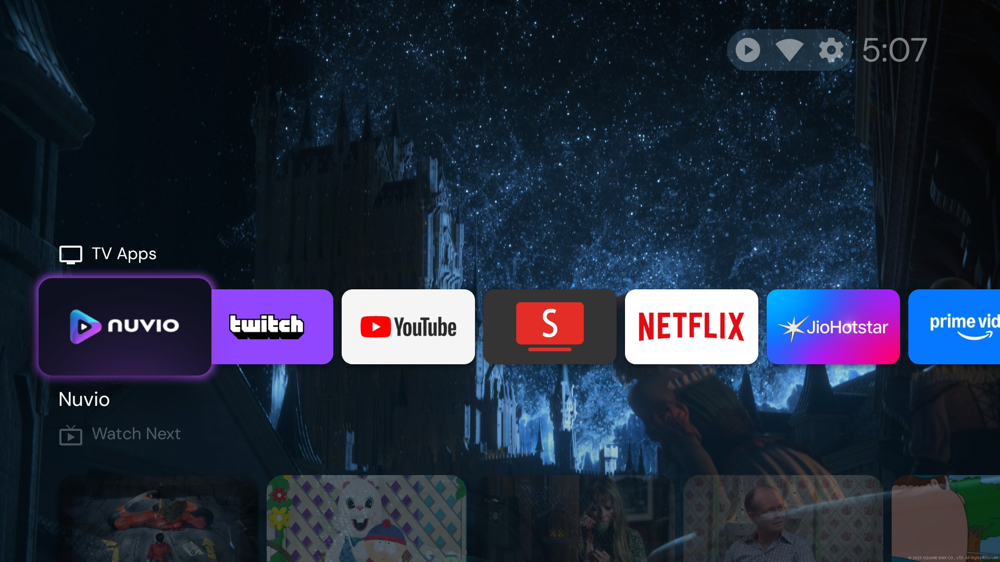
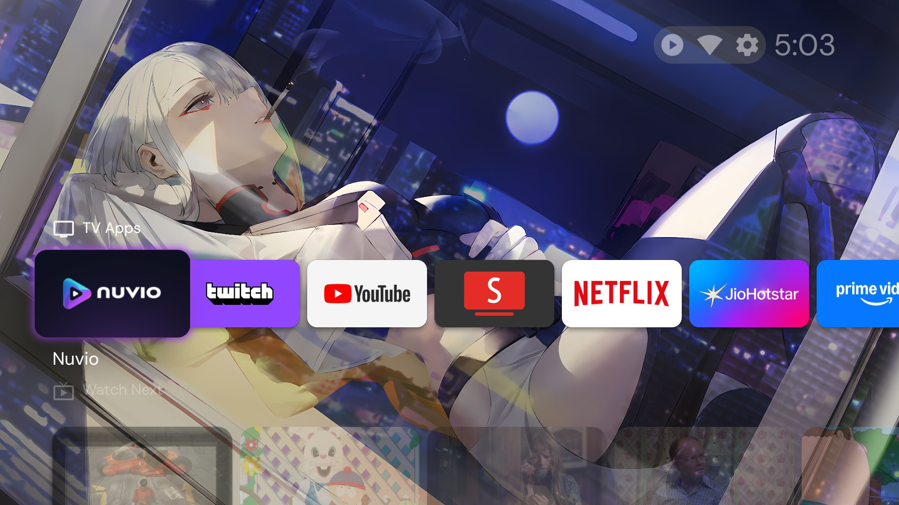

# omae-wa-mou-debloated

> *"Omae wa mou debloated."* — your Google TV, a few minutes before it notices it's fast now.
> *NANI?!*

A no-root, fully reversible kit to debloat and speed up an **Android / Google TV** over Wi-Fi ADB — and to make the tweaks **survive reboots**, which most guides quietly skip.
Built and tested on a **Xiaomi TV X Pro 2025 (Google TV, Android 14, 2 GB RAM)** running **Projectivy Launcher**, but everything is configurable for other TVs.

<p align="center">
  
  
  
  
</p>
<p align="center"><sub>Projectivy Launcher with wallpapers cycled from Wallhaven by the Booru Wallpaper Provider plugin.</sub></p>

## What it does

| | |
|---|---|
| **Debloat (reversible)** | A tiered package list (`LOW` / `CONDITIONAL` / `DNT`) applied in small batches with a health check in between. `pm disable-user` only — nothing is uninstalled. |
| **Keeps background apps asleep** | Every app you install (automatically, no list to maintain) gets its background activity blocked and is force-stopped when it's not on screen. Your launcher, keyboard, accessibility apps and launcher wallpaper plugins are protected automatically. |
| **Survives reboots** | Android resets these limits (and on Xiaomi, animation speed) at every cold boot. A tiny Termux boot agent re-applies everything through the TV's own ADB, then exits — nothing stays in memory. |
| **One-button "fresh boot"** | Key Mapper + a double-press runs a refresh: re-applies everything and clears cached apps in ~4 s, then flashes the volume bar as a "done" signal. |
| **Snappier UI** | 0.5× animations, plus a few safe settings tweaks. |
| **Measured, not folklore** | Every change was verified on a real TV, and several popular "tweaks" were *measured and rejected* (see [docs/07-measuring.md](docs/07-measuring.md)). |

## Results on the test TV

| | Before | After |
|---|---|---|
| Free memory 4–5 min after boot | 530 MB | **612 MB** |
| App processes after boot | 40 | **33** |
| Memory swapped to zram after boot | 568 MB | **383 MB** |
| Stuck AirPlay daemon (100% of a CPU core) | yes | gone |
| Apps auto-starting at boot (Surfshark, Spotify, Prime…) | running | asleep |

Your numbers will differ — use [`scripts/pc/Audit.ps1`](scripts/pc/Audit.ps1) to get your own before/after.

## Quick start (Windows)

You need a PC on the same Wi-Fi as the TV. Open **PowerShell** in this repo's folder.

**1. Install ADB** (Google's official platform-tools):
```powershell
winget install --id Google.PlatformTools -e
```

**2. Turn on debugging on the TV:** Settings → System → About → click *Android TV OS build* 7× → back to System → **Developer options** → **Wireless debugging** → On. Note the IP shown there.

**3. Connect** (replace with your TV's IP; approve the prompt on the TV and tick *Always allow*):
```powershell
adb connect 192.168.1.50:5555
```
If 5555 is refused, use *Pair device with pairing code* — see [docs/01-adb-setup.md](docs/01-adb-setup.md).

**4. Look before you touch** (read-only):
```powershell
.\scripts\pc\Audit.ps1 -Device 192.168.1.50:5555
```

**5. Debloat** — dry run first, then for real (pauses after every 3 packages so you can test):
```powershell
.\scripts\pc\Debloat.ps1 -Device 192.168.1.50:5555 -List .\lists\xiaomi-google-tv.txt -Tier LOW -WhatIf
.\scripts\pc\Debloat.ps1 -Device 192.168.1.50:5555 -List .\lists\xiaomi-google-tv.txt -Tier LOW
```
`CONDITIONAL` packages (PatchWall, antenna TV, AirPlay…) are opt-in, one by one:
```powershell
.\scripts\pc\Debloat.ps1 -Device 192.168.1.50:5555 -List .\lists\xiaomi-google-tv.txt -Tier CONDITIONAL -Only com.mitv.tvhome.atv,com.mitv.tvhome.oemtab
```

**6. Edit the CONFIG block** at the top of [`scripts/device/tv-apply.sh`](scripts/device/tv-apply.sh) (animation speed, which apps may run in the background, etc.), then deploy:
```powershell
.\scripts\pc\Deploy-Scripts.ps1 -Device 192.168.1.50:5555
```

**7. Make it survive reboots** — install the boot agent: [docs/04-boot-agent.md](docs/04-boot-agent.md).

**8. Optional:** remote-button tricks with Key Mapper → [docs/05-key-mapper.md](docs/05-key-mapper.md). Launcher + wallpapers → [docs/06-launcher-and-wallpapers.md](docs/06-launcher-and-wallpapers.md).

**Undo everything:**
```powershell
.\scripts\pc\Debloat.ps1 -Device 192.168.1.50:5555 -Restore
.\scripts\pc\Deploy-Scripts.ps1 -Device 192.168.1.50:5555 -Remove
```

## Docs

1. [ADB setup & pairing](docs/01-adb-setup.md)
2. [Audit & debloat](docs/02-audit-and-debloat.md)
3. [Settings tweaks](docs/03-settings-tweaks.md)
4. [Boot agent (make it stick)](docs/04-boot-agent.md)
5. [Key Mapper: remote buttons & the refresh button](docs/05-key-mapper.md)
6. [Launcher & wallpapers (Projectivy + Wallhaven)](docs/06-launcher-and-wallpapers.md)
7. [Measuring jank (what helped, what didn't)](docs/07-measuring.md)
8. [Troubleshooting](docs/08-troubleshooting.md)

## Tools used

| Tool | What for |
|---|---|
| [Android SDK Platform-Tools](https://developer.android.com/tools/releases/platform-tools) | `adb` on the PC |
| [Projectivy Launcher](https://play.google.com/store/apps/details?id=com.spocky.projengmenu) | ad-free home screen |
| Booru Wallpaper Provider (Projectivy plugin, `nl.kurocon.plugin.wallpaperprovider.booru`) | rotating wallpapers from [Wallhaven](https://wallhaven.cc) |
| [Termux](https://github.com/termux/termux-app) + [Termux:Boot](https://github.com/termux/termux-boot) | boot agent that re-applies tweaks |
| [ADB Auto Enable](https://github.com/mouldybread/adb-auto-enable) | turns wireless debugging back on at boot |
| [Key Mapper](https://github.com/keymapperorg/KeyMapper) | remap remote buttons, run the refresh |

## Safety

- No root, no flashing, no uninstalling. Every change is `disable-user`, a setting, or an app-op — all reversible.
- Debloat runs in batches of 3 with a health check; test Home, Back, an HDMI input and a streaming app between batches.
- Keeping ADB reachable on your LAN is a trade-off: only approved keys can connect, but don't do this on networks you don't trust.
- Things that **broke** on the test TV are documented as `DNT` with the reason — read them before going off-list.

## License

MIT — see [LICENSE](LICENSE). Not affiliated with Xiaomi, Google, Projectivy, Termux or Key Mapper. Use at your own risk.
