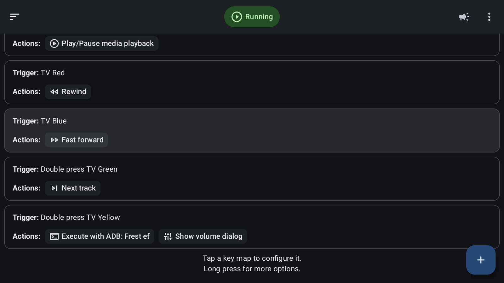

# 5. Key Mapper: remote buttons & the refresh button

> **Easier:** double-click `Start-Here.cmd` and the setup wizard does this for you. This page explains what it does, and how to do it by hand.



[Key Mapper](https://github.com/keymapperorg/KeyMapper) is free and open source, and it works with a TV remote. The mappings in the screenshot are just **examples** of what one person liked; make your own.

## Install
Get the `…-foss.apk` from <https://github.com/keymapperorg/KeyMapper/releases>, check the SHA-256 shown on the release, then:
```powershell
adb install .\keymapper-<version>-foss.apk
```
On the TV: Settings → System → Accessibility → **Key Mapper** → On. It runs alongside Projectivy's accessibility service without problems.

## Find out what your buttons send
Key Mapper's **Record trigger** captures any button. To see the raw codes yourself:
```powershell
adb shell getevent -lt      # press buttons, Ctrl+C to stop
```
On the test TV: Live TV = `KEY_MEMO`, PatchWall/Mi = `KEY_WWW`. Buttons for apps you've disabled (e.g. PatchWall) are free to reuse.

## Example ideas
| Trigger | Action |
|---|---|
| Live TV (unused without an antenna) | Launch app → your favourite streaming app |
| Colour buttons | Rewind / Fast forward / Play-Pause / Next track |
| Double press of any spare button | **The refresh button** (below) |

## The refresh button ("fresh boot without rebooting")
Runs [`tv-refresh.sh`](../scripts/device/tv-refresh.sh): re-applies everything and clears cached apps in about 4 s, never touching the app on screen.

1. Make sure the scripts are on the TV (`Deploy-Scripts.ps1`).
2. **Expert Mode** is needed so Key Mapper can run commands with ADB rights. Start it once:
   ```powershell
   adb shell sh /storage/emulated/0/Android/data/io.github.sds100.keymapper/start.sh
   ```
   On many TVs Key Mapper's own "Auto start" can't work: it needs a pairing code typed into a notification, which Google TV can't do. Leave `START_KEYMAPPER_EXPERT_MODE=1` in `tv-apply.sh` and the boot agent restarts it at every boot. Then turn off Key Mapper's own *Auto start and keep alive*, so you don't get "Starting Expert Mode failed" notifications.
3. New key map → record your trigger (e.g. **double press** a colour button) → Add action → **Shell command**:
   - Script: `sh /data/local/tmp/tv-refresh.sh`
   - Execution mode: **ADB**
4. Add a second action, **Show volume dialog**. Key Mapper waits for the script to finish, so the volume bar flashes exactly when the refresh is done. That's a non-intrusive "done" signal that needs no notifications.

### No notification clutter
Key Mapper always keeps one or two minimum-priority notifications posted (key map status, keyboard toggle), and
launchers like Projectivy show them as a badge on the home screen. `tv-apply.sh` hides them every time it runs
(at boot, and every time you press the refresh button) by snoozing them for 30 days (`QUIET_APPS`). Key Mapper
posts them again whenever it restarts, so the background helper (`tv-daily.sh`) checks every minute and hides any
that came back. The app is not touched: no permission changes, no restarts.

Don't fix this by revoking Key Mapper's notification permission: revoking restarts the app, which itself posts
"Accessibility service needs restarting!", and some firmwares grant the permission back at boot anyway. The
`POST_NOTIFICATION` app-op is ignored on Android 13+, and Key Mapper's own **Settings > Show pause/resume
notification** opens Android's per-channel notification screen, which Google TV doesn't have (Key Mapper crashes
and restarts).

### Why the volume bar and not a toast?
On some firmwares an app's toasts are blocked together with its notifications ("Suppressing toast … by user
request"). The volume bar works everywhere. (The shell can't show the volume UI itself on some firmwares, so it has
to be Key Mapper's action.)

## Costs
Key Mapper ≈ 50 MB plus Expert Mode ≈ 47 MB of always-resident memory. Worth it if you use it; skip Expert Mode if you don't need the refresh button.
