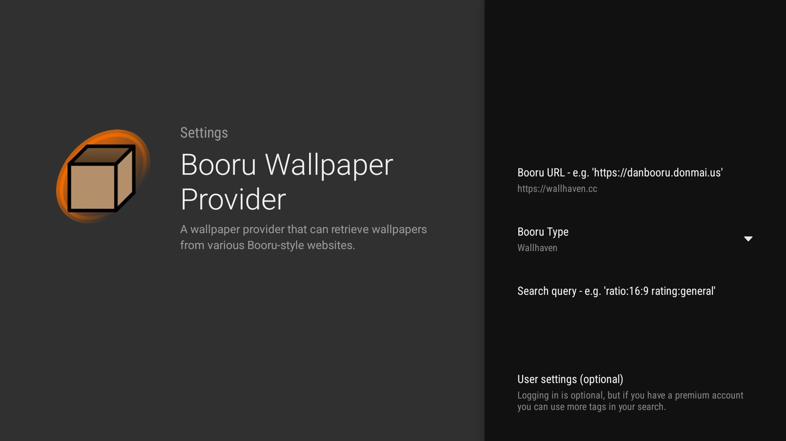

# 6. Launcher & wallpapers

> **Easier:** double-click `Start-Here.cmd` and the setup wizard does this for you. This page explains what it does, and how to do it by hand.

<p>
  
  
</p>

## Projectivy Launcher
[Projectivy Launcher](https://play.google.com/store/apps/details?id=com.spocky.projengmenu) replaces the ad-heavy Google TV home. Install it from the Play Store, then follow its setup to make it the default home and enable its accessibility service (that's what lets it take over the Home button).

- Keep the **stock Google TV launcher enabled**. On the test TV, Projectivy's Home-button takeover and the Settings key depend on it (see [02](02-audit-and-debloat.md#lessons-from-the-test-tv)).
- Use Projectivy's own **backup** before experimenting.

## Rotating wallpapers from Wallhaven
The **Booru Wallpaper Provider** plugin for Projectivy (package `nl.kurocon.plugin.wallpaperprovider.booru`) fetches wallpapers from Booru-style sites, Wallhaven included.

In the plugin's settings:
| Field | Value |
|---|---|
| Booru URL | `https://wallhaven.cc` |
| Booru Type | `Wallhaven` |
| Search query | optional, e.g. `ratio:16:9` or Wallhaven tags; empty = anything |
| User settings | optional login, only for premium tags |

Then pick it as the wallpaper source in Projectivy's appearance settings.

### Ask for the next wallpaper over ADB
Projectivy listens for the same "wallpaper updated" broadcast the plugin sends:
```powershell
adb shell am broadcast -a tv.projectivy.plugin.action.WALLPAPER_PROVIDER_UPDATED -n com.spocky.projengmenu/.receivers.WallpaperProviderUpdateReceiver
```
The provider decides when it actually changes, so expect a new wallpaper about every 2nd–3rd request (wait ~25 s between tries). That's how the screenshots here were made.

## Performance notes (measured)
On a 2 GB TV with a small Mali GPU, Projectivy is **GPU-bound**: the UI thread needs about 3 ms per frame, but the GPU needs about 21 ms. That's ~40 fps instead of 60.
- Wallpaper **blur / brightness / contrast / saturation** effects cost GPU time on every frame; keep them neutral.
- A **still image** is cheaper than a GIF or video background.
- "First navigation after idle is janky, then smooth" is memory being paged back in from zram. Debloating and keeping background apps asleep reduce it.
