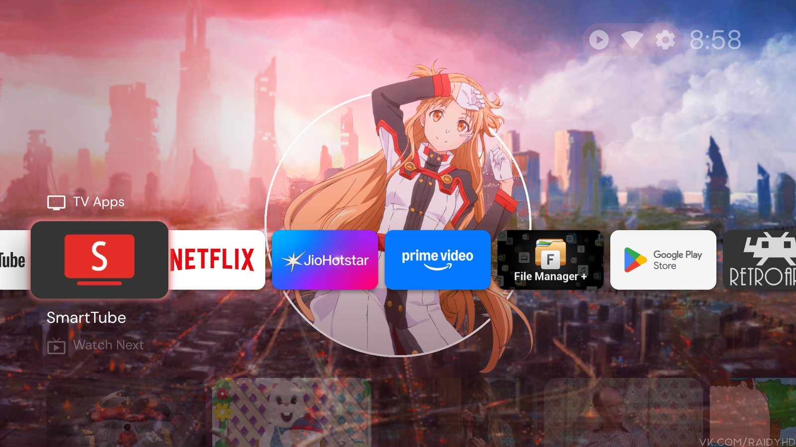
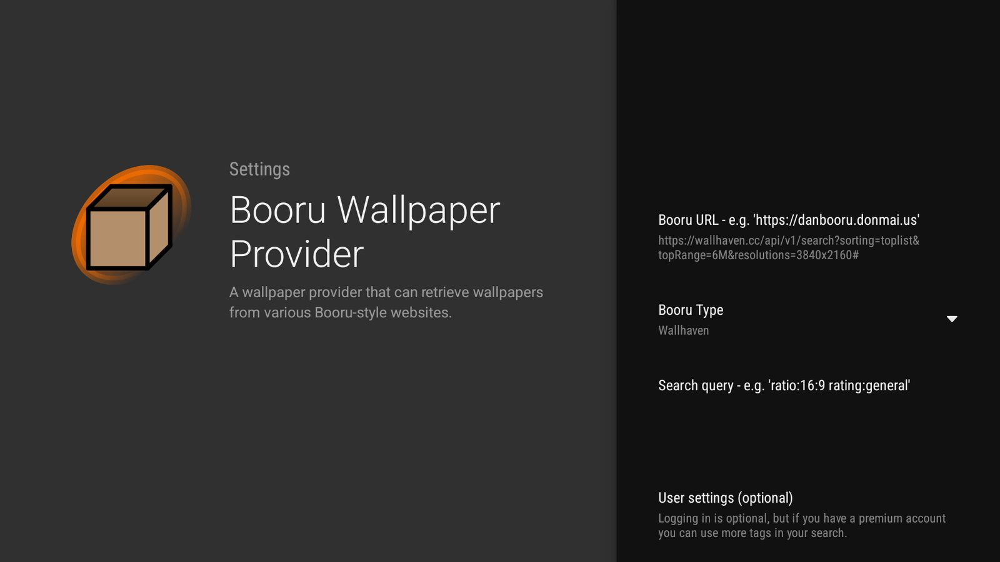

# 6. Launcher & wallpapers

> **Easier:** double-click `Start-Here.cmd` and the setup wizard does this for you. This page explains what it does, and how to do it by hand.

<p>
  
  
</p>

## Projectivy Launcher
[Projectivy Launcher](https://play.google.com/store/apps/details?id=com.spocky.projengmenu) replaces the ad-heavy Google TV home. Install it from the Play Store, then follow its setup to make it the default home and enable its accessibility service (that's what lets it take over the Home button).

- Keep the **stock Google TV launcher enabled**. On the test TV, Projectivy's Home-button takeover and the Settings key depend on it (see [02](02-audit-and-debloat.md#lessons-from-the-test-tv)).
- Use Projectivy's own **backup** before experimenting.

## Rotating wallpapers from Wallhaven
The **Booru Wallpaper Provider** plugin for Projectivy (package `nl.kurocon.plugin.wallpaperprovider.booru`) fetches
wallpapers from Booru-style sites, Wallhaven included.

In the plugin's settings:
| Field | Value |
|---|---|
| Booru Type | `Wallhaven` |
| Booru URL | 4K TV: `https://wallhaven.cc/api/v1/search?sorting=toplist&topRange=6M&resolutions=3840x2160#`<br>1080p TV: `https://wallhaven.cc/api/v1/search?sorting=toplist&topRange=6M&resolutions=1920x1080#` |
| Search query | leave empty (with the URL above it's ignored; put `&q=...` in the URL instead) |
| User settings | optional Wallhaven login/API key |

That's **the most popular wallpapers of the last 6 months, in exactly your TV's resolution**, safe-for-work only.
The wizard prints the right one for your TV (it reads the panel resolution with `adb shell wm size`).

Then in Projectivy: **Settings > Appearance > Wallpaper > Launcher wallpaper**, scroll to the bottom of the list and
pick **Booru Wallpaper Provider**.

### Why the URL looks like that
The plugin builds its request as `<Booru URL>/api/v1/search?q=<search>&sorting=random`, and the search box is
URL-encoded, so Wallhaven's filters can't go in there. The Booru URL field is used as typed, so the filters go
there instead, and the trailing `#` turns everything the plugin appends into a URL fragment, which is never sent
to the server. Wallhaven only sees your filters.

Change it to taste (all [Wallhaven API](https://wallhaven.cc/help/api) parameters work):
| Want | Change |
|---|---|
| Top of the last month / 3 months / year | `topRange=1M` / `3M` / `1y` |
| Anime only / no anime | add `&categories=010` / `&categories=100` |
| A theme | add `&q=nature` (or any Wallhaven tag) before the `#` |
| Random instead of top | `sorting=random` (and drop `topRange`) |

Exact resolution matters on small TVs: a 6K image decodes to about 85 MB of memory, a 4K one to about 33 MB.

### After changing the URL
Projectivy caches the list and only re-asks the plugin every so often. To switch right away: **Launcher wallpaper >
pick another source, then pick Booru Wallpaper Provider again**. Check **Show wallpapers**: the names are Wallhaven
image IDs, so you can look any of them up at `https://wallhaven.cc/w/<id>`.

### A fresh 24 every hour, through the whole toplist (optional)
With the URL above, Projectivy asks about once an hour and gets the **same top 24** every time. Wallhaven can't
return "a random 24 from the toplist" (its random sort ignores `topRange`), so this needs a tiny helper in between:
[`scripts/wallhaven-shuffle`](../scripts/wallhaven-shuffle), one free Vercel function with no dependencies.

- It reads the whole toplist (e.g. the last 3 months in 4K: ~750 wallpapers), shuffles it, and answers the plugin
  in Wallhaven's own format with the next 24. One pass shows every wallpaper once, then it reshuffles; new uploads
  join as the toplist changes.
- It works by the clock (a new set every 55 minutes), so it needs no database. Sets that come up while the TV is
  off are skipped and appear in a later pass.
- Every toplist page is cached by Vercel's CDN on its own (6 hours, then refreshed in the background), so the
  plugin gets an answer in well under a second and Wallhaven sees each page about four times a day. Vercel's
  outgoing addresses are shared, and so is Wallhaven's rate limit: pages it refuses are simply asked for again a
  couple of minutes later, and progress is never lost.
- On a cold start (first use, or after the cache was dropped) the plugin gets the toplist's first page within ~5 s
  while the list is built; the shuffle takes over about a minute later.

**Deploy your own** (free Vercel account): **Add New > Project**, import your fork of this repo, set **Root
Directory** to `scripts/wallhaven-shuffle`, deploy. Or from that folder: `npx vercel deploy --prod`. Optional
environment variables:

| Variable | Default | Meaning |
|---|---|---|
| `TOP_RANGE` | `3M` | `1d` `3d` `1w` `1M` `3M` `6M` `1y` |
| `RESOLUTIONS` | `3840x2160` | exact sizes, e.g. your TV's `wm size` (used when `ATLEAST` is not set) |
| `ATLEAST` | (none) | a minimum size instead, e.g. `3840x2160`: 4K and anything larger |
| `RATIOS` | (none) | aspect ratios, e.g. `16x9,16x10` |
| `MAX_WIDTH` | `0` | skip wider images, e.g. `3840`: 5K/8K files are slow for a small TV to decode (`0` = no limit) |
| `CATEGORIES` | `111` | general / anime / people as 0-1 flags: `110` = no People |
| `PURITY` | `100` | SFW only |
| `MIN_FAVORITES` | `0` | skip wallpapers with fewer favourites (the toplist is every upload, ranked) |

The toplist is really every upload in the range, ranked, so the bottom half is weak (median ~16 favourites).
A good balance, measured for General + Anime, SFW: **`TOP_RANGE=6M`, `ATLEAST=3840x2160`, `RATIOS=16x9,16x10`,
`MIN_FAVORITES=50`, `MAX_WIDTH=3840`**: about 300 wallpapers for the TV, a full pass every ~12 hours. With a
favourites minimum the list stops reading once two pages in a row have none left that qualify. Why these ratios:
16:9 fills a TV and 16:10 fills most laptops. With "Fill", either one crops only a sliver on the other kind of
screen. 21:9, 4:3 and 5:4 lose a quarter or more of the picture.

Every setting can also go in the address, which wins over the variables:
`/api/v1/search?atleast=3840x2160&ratios=16x9,16x10&fav=50&maxw=3840` (the same works for `/api/list`).

Then set the plugin's **Booru URL** to just `https://<your-project>.vercel.app` (no `#`, no query), re-select the
plugin as described above, and open `https://<your-project>.vercel.app/api/v1/search` in a browser to see the
current set (`meta.shuffle` says which set of how many). To try other settings without redeploying, put them in the
plugin URL instead: `https://<your-project>.vercel.app/r/6M/2560x1440/20`.

### Ask for the next wallpaper over ADB
Projectivy listens for the same "wallpaper updated" broadcast the plugin sends:
```powershell
adb shell am broadcast -a tv.projectivy.plugin.action.WALLPAPER_PROVIDER_UPDATED -n com.spocky.projengmenu/.receivers.WallpaperProviderUpdateReceiver
```
Projectivy decides when it actually changes, so expect a new wallpaper about every 2nd or 3rd request (wait ~25 s between tries). That's how the screenshots here were made.

## Performance notes (measured)
On a 2 GB TV with a small Mali GPU, Projectivy is **GPU-bound**: the UI thread needs about 3 ms per frame, but the GPU needs about 21 ms. That's ~40 fps instead of 60.
- Wallpaper **blur / brightness / contrast / saturation** effects cost GPU time on every frame; keep them neutral.
- A **still image** is cheaper than a GIF or video background.
- "First navigation after idle is janky, then smooth" is memory being paged back in from zram. Debloating and keeping background apps asleep reduce it.
