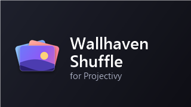

# Wallhaven Shuffle for Projectivy

A wallpaper plugin for [Projectivy Launcher](https://github.com/spocky/projectivy-plugin-wallpaper-provider) that shows
a wallhaven-shuffle list on the TV **in shuffled order with no repeats**: every wallpaper once per round, and none
comes back within 20 changes of itself, also across rounds. These are the same rules as the [Windows app](../windows).
A 70 KB app in plain Java, with no libraries.



**Why not the Booru plugin?** Projectivy keeps whatever a plugin returns for the plugin's cache time (the Booru
plugin: an hour) and at each change shows a **random** one of those. A set of 200 shown once a minute still repeats
a few times an hour, and the set depends on the service answering within seconds, right when the TV asks. This
plugin does it differently:

- **It returns one wallpaper at a time, kept for 30 s.** At every change Projectivy asks again and gets the next
  one in the rotation, so Projectivy's random pick has only one to choose from.
- **The list lives on the TV.** It's downloaded from the service's `/api/list` twice a day, with no time limit, and
  saved as a small file of just what the TV shows (~100 KB). A request reads that file in milliseconds. If the
  service or the network is down, the saved list keeps working.
- **It remembers where it is.** The round in progress survives restarts, updates and power cuts.
- **It's light.** Projectivy calls it once per change, only while the home screen is on. Measured on a 2 GB TV:
  ~1.5 s of CPU in the first 6 minutes, most of it the first list download.

## Install

1. Build it (below), or use a build you trust, and install it: `adb install -r WallhavenShuffle-Projectivy.apk`.
2. Set the service address, either on the TV (**Wallhaven Shuffle** in the app list, or Projectivy's **Configure**
   for the plugin: Service > Address) or over ADB:
   ```powershell
   adb shell am start -n io.github.muknan.wallhavenshuffle/.SettingsActivity --es server "https://<your-project>.vercel.app"
   ```
   The plugin asks for `/api/list` with its own filters (below); with the same filters as the PC, both share one
   cached list.
3. In Projectivy: **Settings > Appearance > Wallpaper > Launcher wallpaper > Wallhaven Shuffle**. Its **Update delay**
   is how often the wallpaper changes.

To go back, choose **Booru Wallpaper Provider** (or anything else) there. Uninstall: `adb uninstall io.github.muknan.wallhavenshuffle`.

## Settings

The settings screen shows the wallpaper on screen with **Next**, **Keep**, **Pause**, **Save to Favourites**, **Add
to playlist** and **Hide**, and on the right a short list of rows, each opening a picker made for the remote:

- **Shuffle from**: the toplist, Favourites and your playlists, in any mix (one round through all of them).
- **Change**: how often. Projectivy's own **Update delay** is how often it asks; the plugin changes at its first ask
  after this time has passed, so the TV can't change faster than Projectivy asks. Next skips the wait.
- **Toplist**: quality, shape, period, popularity, categories, an optional topic, and the largest size (up to 4K is
  lighter for a TV's decoder). The same choices as the Windows app and the remote.
- **Sync**: **Pair with your phone or PC** shows a 6-digit code; type it in the remote (Devices > Pair a device) or on
  the PC (Remote > Pair a device). Paired, the playlists, Favourites and Hidden are shared, the remote can change
  everything here and send Next, Previous or a wallpaper, and Hide on any device leaves it out here too.
- **Service**: the address, and **Get a fresh list now**.

Paired, a background thread checks in every 15 s while the screen is on and the plugin is in use (every 1.5 s
while a remote is open), with one small request. Settings made on the TV while offline go up at the next check-in.

A Next, Previous or Show from the remote is answered at once ("it arrived", and when the change is expected).
Projectivy ignores a refresh within about 30 s of its last ask, so the plugin asks now and again when Projectivy
listens (its last ask + 30 s, then every 31 s, three times at most) until the wallpaper has changed; the remote
counts down to it ("Changing in 0:12"). The remote also shows what Next will bring before it's pressed: the
plugin's pick is seeded, so the preview and the real pick are the same one. When Projectivy lets go of the plugin
(another app opened), the remote is told "Not on the home screen" straight away and checking stops until it binds
again. Coming from 1.7, the old list address and width carry over as the same filters.

## Panel reset (MediaTek TVs)

The plugin also carries the fix for a MediaTek firmware fault: after a 25 fps video the panel stays at 50 Hz and the
home screen judders until a restart. `PanelResetActivity` plays a silent black 24 fps clip in a 2-pixel corner for
under a second, which puts the panel back to 60 Hz; nothing shows on screen. The TV's background helper starts it by
itself when needed ([docs/09](../../../docs/09-extras.md#home-screen-judders-after-a-video-until-you-restart)). By hand:

```powershell
adb shell am start -n io.github.muknan.wallhavenshuffle/.PanelResetActivity
```

## Next wallpaper from the remote

```powershell
adb shell am broadcast -a io.github.muknan.wallhavenshuffle.NEXT -n io.github.muknan.wallhavenshuffle/.NextReceiver
```

Bind that to a button with Key Mapper (action: Shell command, ADB mode). Projectivy shows the next one right away
(whatever the **Change** interval), but it accepts a refresh only about every half minute, so a second press
straight after does nothing. The settings screen and the remote have the same button.

## Build

Needs a JDK 17 and the Android SDK command-line tools with `platforms;android-34` and `build-tools;34.0.0` (no
Android Studio, no Gradle). By default, `build.ps1` looks for them in `%USERPROFILE%\.whs-build\` (`jdk-*`, `sdk`).
`JAVA_HOME` and `ANDROID_SDK` override that.

```powershell
powershell -ExecutionPolicy Bypass -File build.ps1 -Test   # rotation and settings tests on the PC, then bin\WallhavenShuffle-Projectivy.apk
```

The first build creates a signing key in `%USERPROFILE%\.whs-build\` (`whs-plugin.jks` and `.pass`). Keep both:
Android only installs an update that's signed with the same key. Neither ever goes into the repo.

## How it fits together

- `src/.../Shuffle.java`, `TvSettings.java`: the rotation and the settings with their list query (plain Java,
  tested by `test/ShuffleTest.java` on the PC).
- `src/.../ListStore.java`: downloads, compacts and reads the toplist for the current filters.
- `src/.../Sync.java`: pairing, the check-in loop, the shared playlists (`doc.json`) and remote commands.
- `src/.../ShuffleService.java`: what Projectivy calls (`getWallpapers` for TIME_ELAPSED; settings for
  Projectivy's backup): the mixed pool, pause, keep, the Change interval, Next / Previous / Show from the remote.
- `src/.../SettingsActivity.java`, `NextReceiver.java`: the settings screen and "next wallpaper".
- `src/.../PanelResetActivity.java`: the 60 Hz panel reset (makes its clip on the TV with MediaCodec on first use).
- `aidl/` and `src/tv/projectivy/...`: Projectivy's plugin interface, from
  [projectivy-plugin-wallpaper-provider](https://github.com/spocky/projectivy-plugin-wallpaper-provider) (Apache 2.0),
  with the two data classes written in Java to the same layout.
